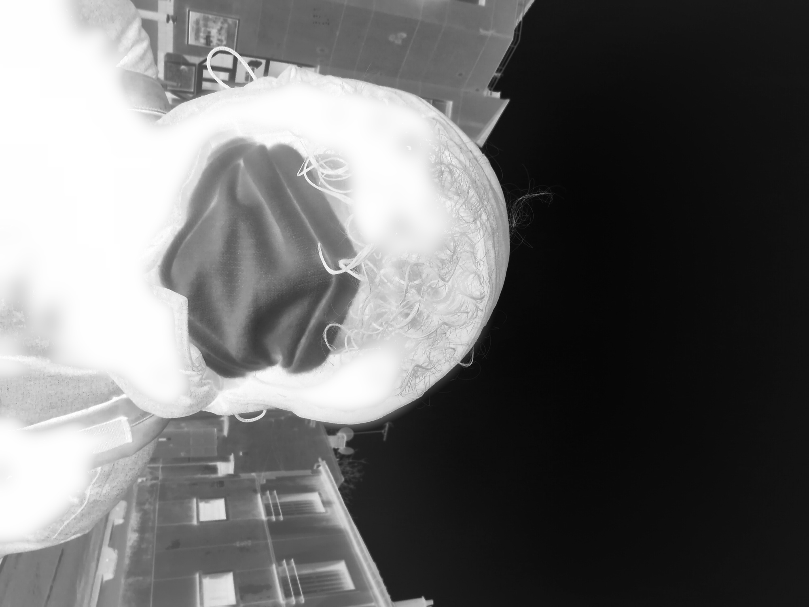
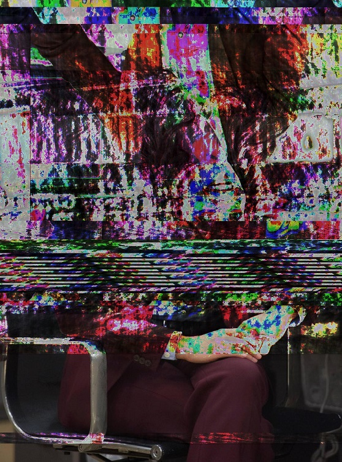

I'm stuck into inverted greyscale with glowing on the whites pics for a while now.

I used to be into glitch art a lot.

I might try to do both at the same time.

For now I did vibe code an app using python that makes exactly the kind of pics I was making using GIMP. With my app I just have 2 parameters to tweak and can clearly see the potential of each pics very fast.
Here is the link: <https://github.com/llllIIIIlllIIl/white-luminance-greyscale-color-inverter>

So I do need now to find a way to do the fastidious process I used to do on Audacity to glitch pictures with some python on pics in the bitmap format (because it's easier to make modifs on pics with this format without breaking the code)
Result will be interesting.

I'll post under what I'll manage to get:
